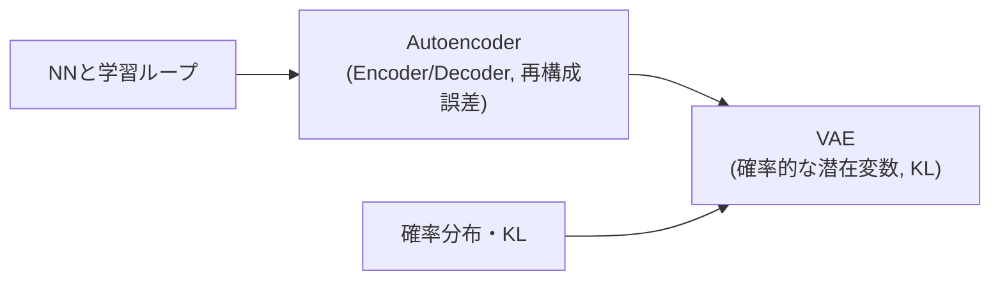

# ステージ設計の原則
本ファイルは，到達目標から教材のステージを設計する方法を定める．
設計の結果は `curriculum_plan.md`（テンプレート: `templates/curriculum_plan.md`）に記入する．

---

# 1. 到達目標を書く
到達目標は「〜を理解する」ではなく，**確認できる行動**で書く．

| 悪い例 | 良い例 |
| :--- | :--- |
| VAEを理解する | VAEの目的関数（ELBO）の各項の役割を説明でき，PyTorchで実装して潜在空間からサンプリングできる |
| Transformerが分かる | Self-Attentionの計算を行列で説明でき，小さなTransformerで系列の分類を学習できる |

到達目標は2〜4個の「説明できる」「実装できる」「比較できる」に分解し，各項目をどのステージで達成するかを設計書に対応づける．

---

# 2. 前提知識を逆算する
1. 到達目標の概念を構成する要素を列挙する（例: VAE = Encoder/Decoder構造 + 確率的な潜在変数 + 再パラメータ化 + KLダイバージェンス）．
2. 各要素について「これを理解するには何を知っている必要があるか」を，学習者の既習範囲に達するまで再帰的にたどる．
3. 得られた概念の依存関係を有向グラフ（mermaid）で書き，トポロジカル順に並べる．
4. 学習者の既習範囲にある概念は，ステージにせず「前提」として明記する．

例: 到達目標「VAE」，学習者「PyTorchは初学者」

---

# 3. ステージに刻む
## 3.1 1ステージ1新概念
- 1つのステージで新しく導入する概念は1つ（多くても密接に関連する2つ）にする．
- 前のステージとの差分が「モデル」「目的関数」「評価・可視化」のどれか1か所に収まるように刻む．2か所以上変わる場合はステージを分ける．
- 差分が小さすぎて新しい学びが無いステージは，前後のステージに統合するか発展課題に回す．

## 3.2 限界が次の動機になる
各ステージには，次のステージへの「橋渡し」として，**そのステージの手法では解決できないこと**を1つ設定する．
橋渡しは，可能な限り実験や可視化で学習者が観察できるものにする．

| ステージ | 観察できる限界 | 次のステージ |
| :--- | :--- | :--- |
| NN（分類） | 入力の表現そのものは学習していない | AE |
| AE | 潜在空間の点の間を補間すると，数字にならない画像が生成される | VAE |
| VAE | 潜在表現は入力の再構成のための情報をすべて保持する．分類に不要な情報も残る | Deep VIB |

## 3.3 ステージの種類
| 種類 | 役割 | 位置 |
| :--- | :--- | :--- |
| 基礎 | 共通骨格と最初の概念を導入する | 最初（1ステージ） |
| 本線 | 到達目標に向かって概念を1つずつ積み上げる | 中盤 |
| 可視化 | 本線の手法の内部を観察する（例: 潜在空間を2次元にして散布図を描く） | 本線の途中または直後 |
| 到達 | 到達目標の手法 | 本線の最後 |
| 発展 | 到達目標の手法の応用・比較・変形 | 到達の後（1〜3ステージ） |

ステージ数の目安は，本線と到達で3〜6，全体で4〜10とする．

## 3.4 ステージの規模
- 1ステージを読む・実行する・考える時間の合計を30〜60分とする．
- 学習時間はColabのGPUで5分以内とする．収まらない場合は，データの一部のみ用いる，モデルを小さくする，エポック数を減らす等で調整する．
- 共通ハイパーパラメータは全ステージで揃え，結果の差を差分のみに帰着できるようにする．

---

# 4. 問いを設計する
## 4.1 実験前に考える
- **実験で答え合わせができる**問いにする．観察できない問い（「なぜ深層学習はうまくいくのか」等）は避ける．
- 二択や大小比較の形にし，理由も書かせる（例: 「$\beta$ を大きくすると，再構成と圧縮のどちらが勝つと考えるか．その理由は」）．
- 可能であれば数値を予想させる（例: 「0エポック目の10クラス分類のAccuracyは約何%になるか」）．
- 2〜4問とし，少なくとも1問は本ステージの新概念に関するものにする．

## 4.2 実験後に考える
- 実験前の予想と結果を照合させる問いを1問含める．
- 結果の「理由」を考えさせる問いを含める（「なぜ〜なのか」）．
- 次のステージにつながる問いを1問含める（「〜を捨てたい場合，何を制御すればよいか」）．

## 4.3 発展課題
- **1つの定数または1つの関数を変える**だけで試せる課題にする．
- 以下の項目を必ず書く．
  1. 何を変更するか（変数名と値）
  2. 何を比較するか（指標，図）
  3. 予想
- 回答例（折りたたみ）には，変更するコード，実験方法，期待される結果，結果から分かることを書く．
- 保存先が本実験の結果と重ならないよう，`EXPERIMENT_NAME` を変更する等の手順を回答例に書く．

---

# 5. 学習者の前提に応じた調整
| 学習者の前提 | 調整 |
| :--- | :--- |
| PyTorchが初めて | 基礎ステージで，テンソルの形状の確認，DataLoaderの1バッチの表示，学習ループの各行の説明を手厚くする |
| 確率・統計に不安がある | 確率分布やKLダイバージェンスを，実験を伴う独立したステージ（例: 2つの正規分布のKLを数値計算して比較する）として追加する |
| 研究者・経験者 | 基礎ステージを簡潔にし，発展ステージ（比較実験，損失の変形）を増やす |
| 数式が苦手 | 数式の直後に，同じ内容を言葉とコードの両方で説明する |

---

# 6. 避けるべき設計
- 到達目標の手法を最初に提示し，前提を後から説明する（逆算した順序を崩さない）．
- 前のステージと無関係な題材・データセットへの切り替え（差分が見えなくなる）．
- 学習が成立しないハイパーパラメータのまま解説を書く．
- 「実験結果」の節に，実行していない結果や一般論だけを書く．
- 発展課題で複数の変更を同時に求める．
