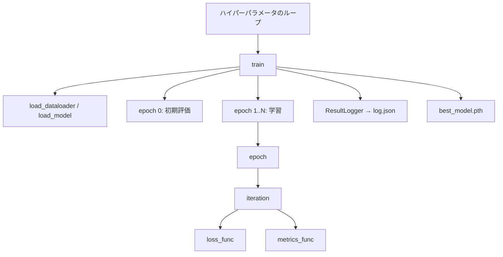

# {{TITLE}}

{{GOAL}}

TODO(AI): 教材の対象者（学習者の前提）と，教材全体の構成を2〜3文で紹介する．各ノートブックは1ファイルで完結し，Google Colab でそのまま実行できることを書く．

## 教材の思想

1. **到達目標から逆算する** — 目標に必要な前提を洗い出し，依存関係の順にステージを並べる．
2. **1ステージ1新概念** — 前のステージとの差分を最小にし，何が結果を変えたのかを明確にする．
3. **限界が次の動機になる** — 各ステージの最後に，その手法では解決できないことを示し，次のステージへつなげる．
4. **同じ骨格** — `iteration` / `epoch` / `train` の学習ループと関数名を全ステージで揃える．ステージごとの変更はモデル，目的関数，評価指標に閉じる．
5. **問い → 予想 → 実験 → 結果 → 考察 → 発展** — 解説の結果・考察・回答例は折りたたみにしてある．自分の予想を書いてから開く．

## ステージの流れ

<!-- learnkit:flow:start -->
<!-- learnkit:flow:end -->

<!-- learnkit:table:start -->
<!-- learnkit:table:end -->

## 共通ハイパーパラメータ

| 項目 | 値 |
|:---|:---|
| データセット | TODO(AI) |
| 前処理 | TODO(AI) |
| 最適化手法 | TODO(AI) |
| 学習率 | TODO(AI) |
| バッチサイズ | TODO(AI) |
| エポック数 | TODO(AI)（0 エポック目は初期評価） |
| シード | TODO(AI) |

TODO(AI): ステージ固有のハイパーパラメータ（例: $\beta$）があれば，その値と理由を書く．

## 関数とクラスの役割

学習処理は次のネスト関係で構成する．



| 名前 | 役割 |
|:---|:---|
| `set_seed` | Python / NumPy / PyTorch の乱数の固定 |
| `ResultLogger` | エポックごとの指標を記録し `log.json` に保存 |
| `load_dataloader` | 学習用・検証用の DataLoader を返す |
| `load_model` | モデルを生成し，必要なら重みを読み込む |
| `loss_func` | **ステージごとに差し替える**目的関数 |
| `metrics_func` | Accuracy，MAE 等の評価指標 |
| `make_teacher_signals` | ミニバッチから教師信号を作る（分類ならラベル，再構成なら入力画像） |
| `iteration` | 1 ミニバッチの順伝播と（学習時は）逆伝播 |
| `epoch` | DataLoader 1 周分の平均指標 |
| `train` | 全エポックの学習と最良モデルの保存 |
| `plot_history` | 学習曲線の描画と `figures/` への保存 |

## 使い方

各ステージは次の順で進める．

1. 解説 `.md` の「0. 位置づけ」〜「3. 実験条件」を読み，**実験前に考える**に答える．
2. ノートブックを Colab で開き（各ファイル冒頭の **Open in Colab** バッジ），**ランタイム → ランタイムのタイプを変更** からハードウェア アクセラレータを **GPU** に設定して，上から順に実行する．ローカルの Jupyter でも実行できる．
3. 解説の **実験結果** を開き，予想と照合する．**実験後に考える** に答えてから **解説** を開く．
4. **発展課題** で定数や目的関数を1つ変え，本実験の結果と比較する．回答例は最後に開く．
5. **次のステージへ** を読み，次のステージに進む．

## 結果の保存先

ノートブックを実行すると，次のディレクトリが作成される（Git の管理外）．

```text
outputs/{実験名}/{最適化手法}/{学習率}_{バッチサイズ}/{seed}/
    best_model.pth
    log.json
datasets/{実験名}/      # 初回のダウンロード時
figures/{実験名}/       # 解説で参照する図
```

同じ条件の `log.json` と `best_model.pth` が既にある場合，学習はスキップされる．

## ライセンス・出典

TODO(AI): 使用したデータセットと，参考にした論文・資料を書く．
