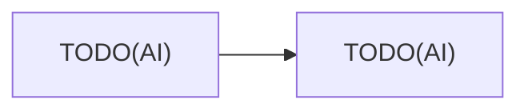

# 教材の設計書: {{TITLE}}

本ファイルは教材の設計書である（公開しない）．`pedagogy.md` の手順に従って記入する．

## 1. 到達目標

{{GOAL}}

TODO(AI): 到達目標を「説明できる」「実装できる」「比較できる」の形で2〜4項目に分解する．

| # | 到達目標の項目 | 達成するステージ |
|:---:|:---|:---|
| G1 | TODO(AI) | TODO(AI) |

## 2. 学習者の前提

| 項目 | 前提 |
|:---|:---|
| プログラミング | TODO(AI) |
| フレームワーク | TODO(AI) |
| 数学 | TODO(AI) |
| 実行環境 | TODO(AI) |

## 3. 前提知識の依存関係

TODO(AI): 到達目標から逆算した概念の依存関係を mermaid で書く．学習者の既習範囲にある概念は点線で示す．

## 4. ステージの一覧

TODO(AI): 各ステージの種類（基礎・本線・可視化・到達・発展），新しく学ぶこと，前ステージとの差分（モデル・目的関数・評価のどこが変わるか），限界（次の動機）を書く．

| # | 種類 | ステージ | 新しく学ぶこと | 差分の箇所 | 限界（次の動機） |
|:---:|:---|:---|:---|:---|:---|
| 1 | 基礎 | TODO(AI) | TODO(AI) | − | TODO(AI) |

## 5. 共通の設定

| 項目 | 値 | 理由 |
|:---|:---|:---|
| データセット | TODO(AI) | TODO(AI) |
| 前処理 | TODO(AI) | |
| 最適化手法 | TODO(AI) | |
| 学習率 | TODO(AI) | |
| バッチサイズ | TODO(AI) | |
| エポック数 | TODO(AI) | 1ステージの学習を Colab の GPU で5分以内に収めるため |
| シード | TODO(AI) | |
| 記号 | 入力 $x$，ラベル $y$，潜在変数 $z$，ミニバッチサイズ $N$ 等 | ステージ間で統一するため |

## 6. 想定されるつまずきと対策

TODO(AI): 学習が成立しない可能性（例: Posterior Collapse，勾配消失）や，学習者が誤解しやすい点と，その対策を書く．

| つまずき | 対策 |
|:---|:---|
| TODO(AI) | TODO(AI) |
